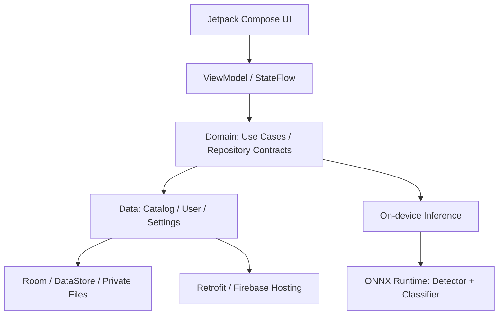

# 🐾 DogID — Nhận diện giống chó bằng AI

**Dự án Android của Nguyễn Việt Anh** · Kotlin · Jetpack Compose · AI trên thiết bị

DogID giúp người dùng nhận diện giống chó từ hình ảnh, tra cứu đặc điểm giống và lưu lại hành trình khám phá cùng thú cưng. Ứng dụng kết hợp nhận diện offline với thư viện giống chó có cache, hồ sơ thú cưng và các thẻ ảnh chia sẻ.

Repository này giới thiệu sản phẩm, kiến trúc và các luồng sử dụng bằng ảnh chụp/video từ ứng dụng thật.

**163 giống chó · Top 5 dự đoán · 20 locale · 27 Gradle modules**

## 🎬 Video demo theo từng luồng

Chọn riêng từng phần bên dưới. Mỗi video bắt đầu tại **Home**, quay liên tục ở **tốc độ thật (1×)** và đi đủ các bước của luồng được mô tả.

| Video | Luồng giới thiệu | Thời lượng |
| --- | --- | --- |
| [▶ 01. Nhận diện và so sánh](videos/01-recognition-comparison.mp4) | Home → Chọn ảnh → Xác nhận ảnh → Crop → AI → Kết quả → Top 5 → Chi tiết giống → So sánh → Home | 01:39 |
| [▶ 02. Khám phá giống chó](videos/02-breed-explorer.mp4) | Home → Khám phá → Danh mục → Tìm kiếm → Chi tiết giống → Bộ lọc → Home | 01:13 |
| [▶ 03. Lịch sử và giống yêu thích](videos/03-history-favorites.mp4) | Home → Lịch sử → Lọc → Xem lại kết quả → Cún → Giống yêu thích → Chi tiết giống → Home | 01:09 |
| [▶ 04. Bộ sưu tập DogDex](videos/04-dogdex.mp4) | Home → DogDex → Đã khám phá → Yêu thích → Chi tiết giống → Home | 00:37 |
| [▶ 05. Hồ sơ thú cưng](videos/05-pet-management.mp4) | Home → Cún → Form thêm cún → Hồ sơ Milo → Album ảnh → Form chỉnh sửa → Home | 00:59 |
| [▶ 06. Tạo thẻ chia sẻ](videos/06-share-card.mp4) | Home → Kết quả gần nhất → Studio chia sẻ → Mẫu và tỷ lệ → Xem trước → Lưu PNG → Home | 00:59 |
| [▶ 07. Cài đặt và trợ giúp](videos/07-settings.mp4) | Home → Cài đặt → Ngôn ngữ → Bộ nhớ → Quyền riêng tư → FAQ → Về DogID → Home | 01:13 |

[Ảnh bìa và hướng dẫn xem từng video](videos/README.md). Nếu GitHub không phát trực tiếp trong trang xem file, chọn **Download raw file** để xem bản MP4.

## 🛠 Công nghệ sử dụng

| Nhóm | Công nghệ và ứng dụng |
| --- | --- |
| Ngôn ngữ | Kotlin; Kotlin Coroutines, Flow/StateFlow/SharedFlow |
| Giao diện | Jetpack Compose, Material 3, Navigation Compose với typed routes, lifecycle-aware state collection |
| Kiến trúc | Clean Architecture, MVVM, Repository Pattern, Use Cases; tổ chức nhiều module |
| Dependency Injection | Hilt, KSP |
| Camera và ảnh đầu vào | CameraX, Android Photo Picker, xử lý EXIF và cắt ảnh |
| AI | ONNX Runtime Android, YOLOX-Nano, model phân loại FP16; preprocessing và postprocessing trên thiết bị |
| Lưu trữ | Room, database migrations, Preferences DataStore, tệp ảnh trong vùng riêng của ứng dụng |
| Kết nối và ảnh mạng | Retrofit, OkHttp, Kotlin Serialization, Coil |
| Firebase | Hosting cho catalog, Remote Config cho cấu hình, Crashlytics cho báo cáo lỗi |
| Kiểm thử | JUnit, Coroutines Test, Compose UI Test, Room migration tests |

## ✨ Tính năng và giao diện

[Tổng quan](#overview) · [Nhận diện](#recognition) · [Tra cứu](#breeds) · [Thư viện](#library) · [Thú cưng](#pets) · [DogDex](#dogdex) · [Chia sẻ](#share) · [Cài đặt](#settings)


<a id="overview"></a>

### Tổng quan

Giao diện Jetpack Compose với hệ thống màu và thành phần dùng chung.

<table>
<tr><th>Trang chủ</th><th>Giới thiệu ứng dụng</th></tr>
<tr><td><a href="screenshots/01-overview/home.png"></a></td><td><a href="screenshots/01-overview/onboarding.png"></a></td></tr>
</table>

<a id="recognition"></a>

### Nhận diện giống chó trên thiết bị

[▶ Xem video 01: Nhận diện và so sánh](videos/01-recognition-comparison.mp4)

Chọn ảnh, điều chỉnh vùng cắt, phát hiện chó và phân loại trực tiếp trên thiết bị. Kết quả hiển thị giống phù hợp nhất và Top 5 dự đoán.

<table>
<tr><th>Điều chỉnh ảnh</th><th>Kết quả nhận diện</th><th>Top 5 dự đoán</th></tr>
<tr><td><a href="screenshots/02-dog-recognition/photo-review.png"></a></td><td><a href="screenshots/02-dog-recognition/recognition-result.png"></a></td><td><a href="screenshots/02-dog-recognition/top-five-predictions.png"></a></td></tr>
</table>

<a id="breeds"></a>

### Tra cứu và so sánh giống chó

[▶ Xem video 02: Khám phá giống chó](videos/02-breed-explorer.mp4)

Khám phá danh mục 163 giống chó, tìm kiếm/lọc, xem thông tin và so sánh hai giống. Catalog được tải qua HTTPS; nội dung đã cache có thể xem lại khi offline.

<table>
<tr><th>Danh mục giống chó</th><th>Thông tin giống</th><th>So sánh hai giống</th></tr>
<tr><td><a href="screenshots/03-breed-explorer/breed-catalog.png"></a></td><td><a href="screenshots/03-breed-explorer/breed-detail.png"></a></td><td><a href="screenshots/03-breed-explorer/breed-comparison.png"></a></td></tr>
</table>

<a id="library"></a>

### Lịch sử và giống yêu thích

[▶ Xem video 03: Lịch sử và giống yêu thích](videos/03-history-favorites.mp4)

Theo dõi lịch sử nhận diện, mở lại kết quả và quản lý các giống yêu thích.

<table>
<tr><th>Lịch sử nhận diện</th><th>Giống yêu thích</th></tr>
<tr><td><a href="screenshots/04-personal-library/scan-history.png"></a></td><td><a href="screenshots/04-personal-library/favorite-breeds.png"></a></td></tr>
</table>

<a id="pets"></a>

### Quản lý hồ sơ thú cưng

[▶ Xem video 05: Hồ sơ thú cưng](videos/05-pet-management.mp4)

Tạo và chỉnh sửa hồ sơ với tên, giống, giới tính, ngày sinh, cân nặng, ghi chú, ảnh đại diện và album ảnh. Milo là hồ sơ demo được tạo cho bộ tài liệu này.

<table>
<tr><th>Danh sách thú cưng</th><th>Chỉnh sửa hồ sơ</th><th>Hồ sơ và album ảnh</th></tr>
<tr><td><a href="screenshots/05-pet-management/pets.png"></a></td><td><a href="screenshots/05-pet-management/pet-edit.png"></a></td><td><a href="screenshots/05-pet-management/pet-profile.png"></a></td></tr>
</table>

<a id="dogdex"></a>

### Bộ sưu tập DogDex

[▶ Xem video 04: Bộ sưu tập DogDex](videos/04-dogdex.mp4)

Theo dõi các giống đã khám phá, tiến độ bộ sưu tập, trạng thái đã quét và các giống yêu thích.

<table>
<tr><th>Bộ sưu tập DogDex</th></tr>
<tr><td><a href="screenshots/06-dogdex/collection.png"></a></td></tr>
</table>

<a id="share"></a>

### Tạo ảnh chia sẻ

[▶ Xem video 06: Tạo thẻ chia sẻ](videos/06-share-card.mp4)

Tùy chọn 6 mẫu thiết kế và 5 tỷ lệ ảnh, xem trước và xuất thẻ PNG để lưu hoặc chia sẻ qua Android Sharesheet.

<table>
<tr><th>Tùy chỉnh thẻ chia sẻ</th><th>Mẫu chia sẻ khác</th></tr>
<tr><td><a href="screenshots/07-share-card/share-editor.png"></a></td><td><a href="screenshots/07-share-card/share-template.png"></a></td></tr>
</table>

<a id="settings"></a>

### Cài đặt và ngôn ngữ

[▶ Xem video 07: Cài đặt và trợ giúp](videos/07-settings.mp4)

Hỗ trợ 20 locale, quản lý bộ nhớ và các mục trợ giúp, quyền riêng tư, thông tin ứng dụng.

<table>
<tr><th>Cài đặt</th><th>Lựa chọn ngôn ngữ</th></tr>
<tr><td><a href="screenshots/08-settings/settings.png"></a></td><td><a href="screenshots/08-settings/language-selection.png"></a></td></tr>
</table>

## 🧩 Kiến trúc và cách tổ chức

Ứng dụng tách giao diện, logic nghiệp vụ và nguồn dữ liệu. ViewModel cung cấp UI state bằng StateFlow, phát sự kiện bằng SharedFlow; Compose thu thập trạng thái theo lifecycle. Hilt cung cấp các implementation cho repository và các thành phần dùng chung.



Sơ đồ thể hiện luồng trách nhiệm; dependency implementation được kết nối qua Hilt.

```text
app/             Điều phối ứng dụng và navigation
domain/          Models, repository contracts, use cases (Kotlin/JVM)
core/            12 module nền tảng và thành phần dùng chung
data/            3 module: catalog, user, settings
feature/         10 module giao diện/tính năng
```

Các quyết định kỹ thuật nổi bật:

- **Pipeline AI trên thiết bị:** kiểm tra ảnh tối, phát hiện chó bằng YOLOX-Nano, kiểm tra số lượng/kích thước/độ mờ, sau đó chạy classifier và tổng hợp Top 5. Model có 191 nhãn đầu ra, được ánh xạ về 163 giống chuẩn hóa.
- **Quản lý tài nguyên inference:** dispatcher riêng, Mutex giới hạn một lượt inference đồng thời, giải phóng tensor/result bằng `use` và xử lý lỗi thiếu bộ nhớ.
- **Catalog có cache:** kiểm tra phiên bản, schema và SHA-256; lưu Room, áp dụng TTL và dùng lại nội dung đã tải khi offline. Nhận diện không cần mạng; lần tải nội dung catalog mới cần kết nối.
- **Dữ liệu người dùng:** tách khỏi cache catalog; giữ migration của Room, quản lý ảnh/draft trong vùng riêng và hàng đợi dọn tệp.
- **Trải nghiệm Android:** typed navigation, khôi phục trạng thái form bằng SavedStateHandle, bản địa hóa và xuất ảnh qua FileProvider/MediaStore/SAF.

Xác suất trong kết quả là mức độ tin cậy của bộ phân loại, không phải tỷ lệ di truyền hay kết quả xét nghiệm giống chó.

## 📁 Cấu trúc tài liệu

```text
DogID_docs/
├── README.md
├── screenshots/
│   ├── README.md
│   ├── 01-overview/
│   ├── 02-dog-recognition/
│   ├── 03-breed-explorer/
│   ├── 04-personal-library/
│   ├── 05-pet-management/
│   ├── 06-dogdex/
│   ├── 07-share-card/
│   └── 08-settings/
└── videos/
    ├── README.md
    ├── covers/
    ├── 01-recognition-comparison.mp4
    ├── 02-breed-explorer.mp4
    ├── 03-history-favorites.mp4
    ├── 04-dogdex.mp4
    ├── 05-pet-management.mp4
    ├── 06-share-card.mp4
    └── 07-settings.mp4
```

Ảnh chụp ngày **17/10/2026**; 7 video được quay lại ngày **18/10/2026** trên **Samsung Galaxy A15 (SM-A155F), Android 16**, DogID **1.0.2**. Video giữ tốc độ thật, bắt đầu và kết thúc ở Home; chỉ cắt phần thanh hệ thống và thêm tiêu đề/bước thao tác ngoài giao diện app. Trong video 1, các thumbnail ngoài ảnh demo ở photo picker hệ thống được che.

Xem [danh mục ảnh](screenshots/README.md) và [hướng dẫn video](videos/README.md).

## 👨‍💻 Tác giả

**Nguyễn Việt Anh — Android Developer**

- GitHub: [vietanh-k04](https://github.com/vietanh-k04)
- Email: [vietanh.work.it@gmail.com](mailto:vietanh.work.it@gmail.com)
