# 🐾 DogID — Nhận diện giống chó bằng AI

DogID giúp người dùng nhận diện giống chó từ hình ảnh, tra cứu đặc điểm giống và lưu lại hành trình khám phá cùng thú cưng. Ứng dụng kết hợp nhận diện offline với thư viện giống chó

## 🎬 Video demo theo từng luồng

| Video | Luồng giới thiệu | Thời lượng |
| --- | --- | --- |
| [▶ 01. Nhận diện và so sánh](videos/README.md#video-01) | Home → Chọn ảnh → Xác nhận ảnh → Crop → AI → Kết quả → Top 5 → Chi tiết giống → So sánh → Home | 01:39 |
| [▶ 02. Khám phá giống chó](videos/README.md#video-02) | Home → Khám phá → Danh mục → Tìm kiếm → Chi tiết giống → Bộ lọc → Home | 01:13 |
| [▶ 03. Lịch sử và giống yêu thích](videos/README.md#video-03) | Home → Lịch sử → Lọc → Xem lại kết quả → Cún → Giống yêu thích → Chi tiết giống → Home | 01:09 |
| [▶ 04. Bộ sưu tập DogDex](videos/README.md#video-04) | Home → DogDex → Đã khám phá → Yêu thích → Chi tiết giống → Home | 00:37 |
| [▶ 05. Hồ sơ thú cưng](videos/README.md#video-05) | Home → Cún → Form thêm cún → Hồ sơ Milo → Album ảnh → Form chỉnh sửa → Home | 00:59 |
| [▶ 06. Tạo thẻ chia sẻ](videos/README.md#video-06) | Home → Kết quả gần nhất → Studio chia sẻ → Mẫu và tỷ lệ → Xem trước → Lưu PNG → Home | 00:59 |
| [▶ 07. Cài đặt và trợ giúp](videos/README.md#video-07) | Home → Cài đặt → Ngôn ngữ → Bộ nhớ → Quyền riêng tư → FAQ → Về DogID → Home | 01:13 |

## 🛠 Công nghệ sử dụng

| Nhóm | Công nghệ và ứng dụng |
| --- | --- |
| Ngôn ngữ | Kotlin; Kotlin Coroutines, Flow/StateFlow/SharedFlow |
| Giao diện | Jetpack Compose, Material 3, Navigation Compose, lifecycle-aware state collection |
| Kiến trúc | Clean Architecture, MVVM, Repository Pattern, Use Cases |
| Dependency Injection | Hilt, KSP |
| Camera và ảnh đầu vào | CameraX, Android Photo Picker, xử lý EXIF và cắt ảnh |
| AI | ONNX Runtime Android, YOLOX-Nano, model phân loại FP16; preprocessing và postprocessing trên thiết bị |
| Lưu trữ | Room, database migrations, Preferences DataStore, tệp ảnh trong vùng riêng của ứng dụng |
| Kết nối và ảnh mạng | Retrofit, OkHttp, Kotlin Serialization, Coil |
| Firebase | Hosting cho catalog, Remote Config cho cấu hình, Crashlytics cho báo cáo lỗi |
| Kiểm thử | JUnit, Coroutines Test, Compose UI Test, Room migration tests |

## ✨ Tính năng và giao diện

[Tổng quan](#overview) · [Nhận diện](#recognition) · [Tra cứu](#breeds) · [Thư viện](#library) · [Thú cưng](#pets) · [DogDex](#dogdex) · [Chia sẻ](#share) · [Cài đặt](#settings)


<a id="overview"></a>

### Tổng quan

Giao diện với hệ thống màu và thành phần dùng chung.

<table>
<tr><th>Trang chủ</th><th>Giới thiệu ứng dụng</th></tr>
<tr><td><a href="screenshots/01-overview/home.png">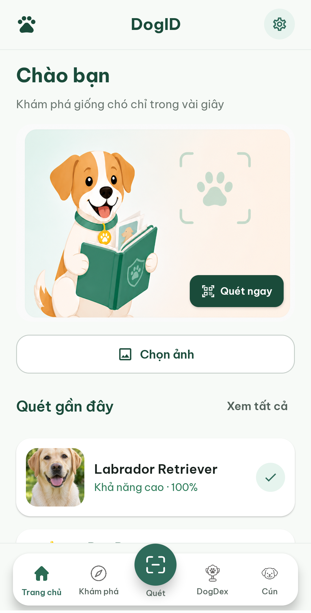</a></td><td><a href="screenshots/01-overview/onboarding.png">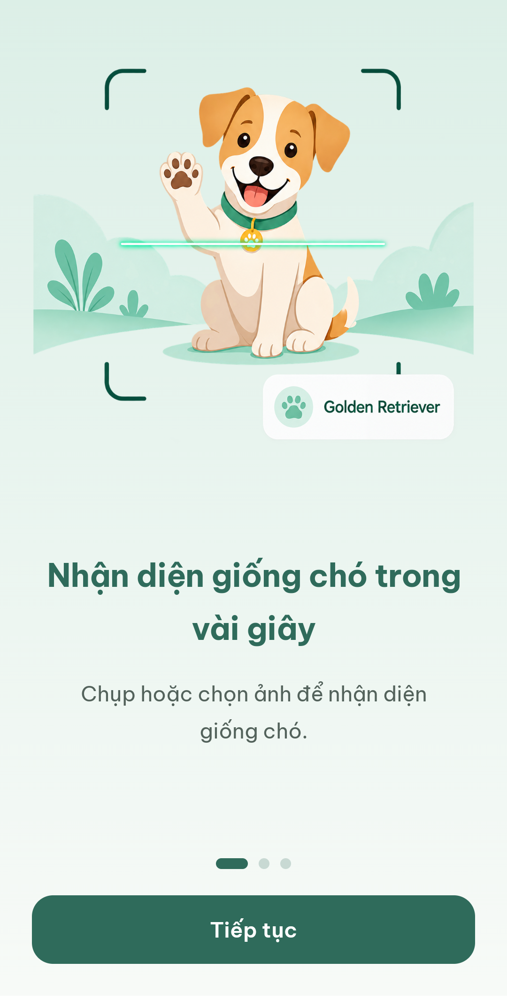</a></td></tr>
</table>

<a id="recognition"></a>

### Nhận diện giống chó trên thiết bị

<details>
<summary>▶ Video 01: Nhận diện và so sánh</summary>

https://github.com/user-attachments/assets/16fd7adc-4fb4-4d60-825e-8c0290ddb2b8

</details>

Từ **Home**, nhấn **Quét ngay** để mở **Camera**, chụp chó hoặc chọn ảnh từ thư viện, sau đó điều chỉnh vùng cắt và nhận diện trực tiếp trên thiết bị. Xem kết quả, Top 5 dự đoán, thông tin giống và so sánh hai giống.

**Luồng ảnh:** Home → Camera → Điều chỉnh ảnh → Kết quả → Top 5 → So sánh. Video 01 minh họa nhánh chọn ảnh từ Home; ảnh Camera bên dưới bổ sung nhánh chụp trực tiếp.

<table>
<tr><th>1. Home · Quét ngay</th><th>2. Camera · Chụp hoặc chọn ảnh</th><th>3. Điều chỉnh ảnh</th></tr>
<tr><td><a href="screenshots/02-dog-recognition/recognition-home.png">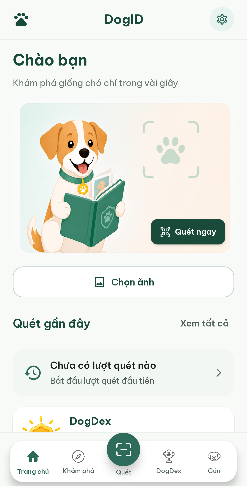</a></td><td><a href="screenshots/02-dog-recognition/camera.png">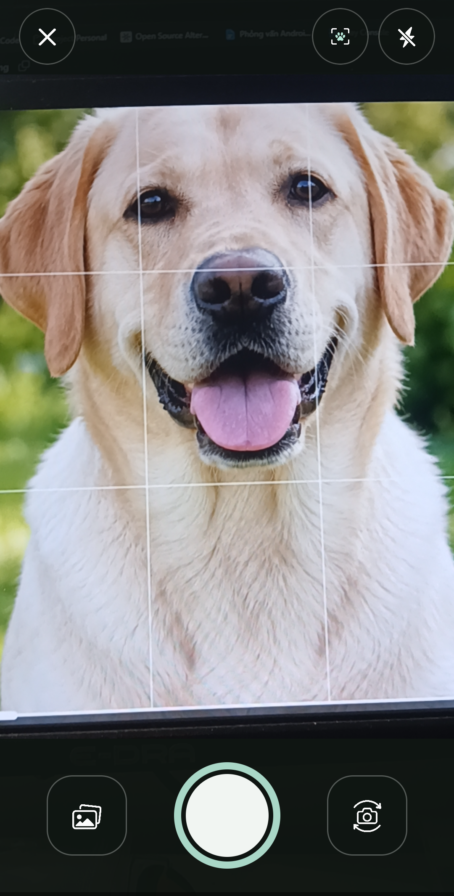</a></td><td><a href="screenshots/02-dog-recognition/photo-review.png">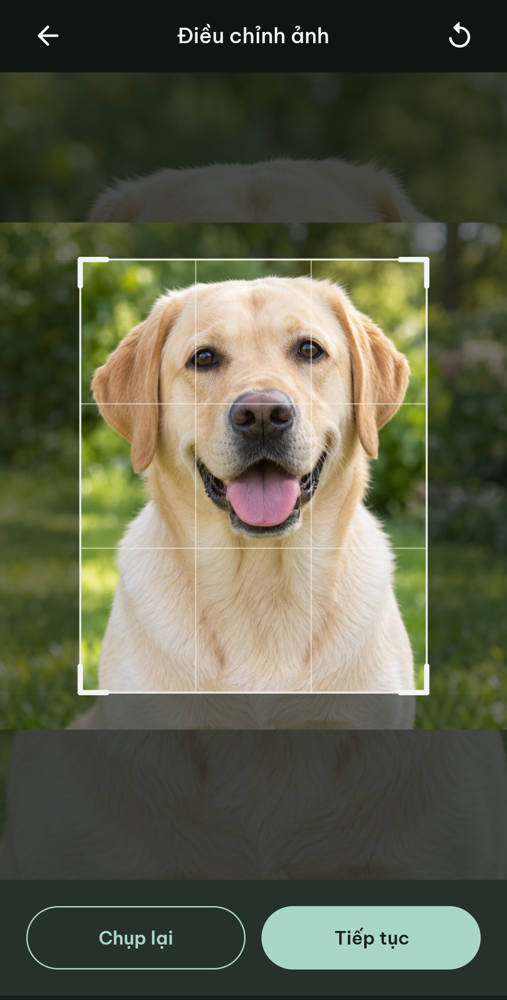</a></td></tr>
<tr><th>4. Kết quả nhận diện</th><th>5. Top 5 dự đoán</th><th>6. So sánh hai giống</th></tr>
<tr><td><a href="screenshots/02-dog-recognition/recognition-result.png">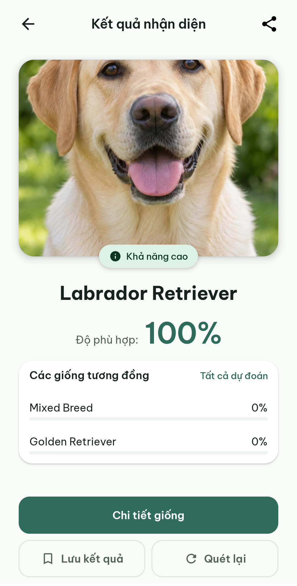</a></td><td><a href="screenshots/02-dog-recognition/top-five-predictions.png">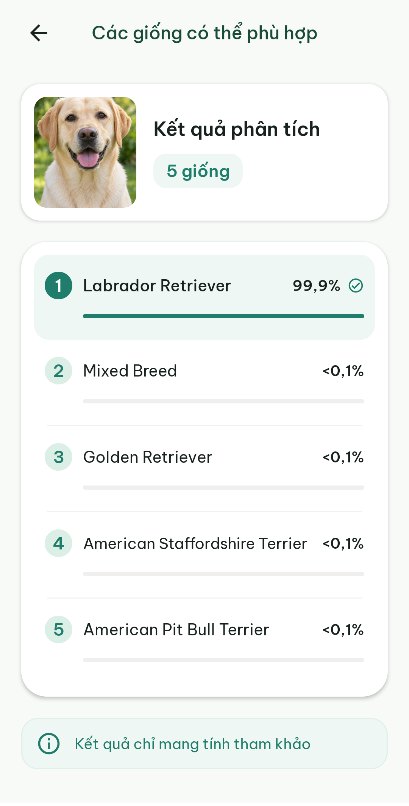</a></td><td><a href="screenshots/03-breed-explorer/breed-comparison.png">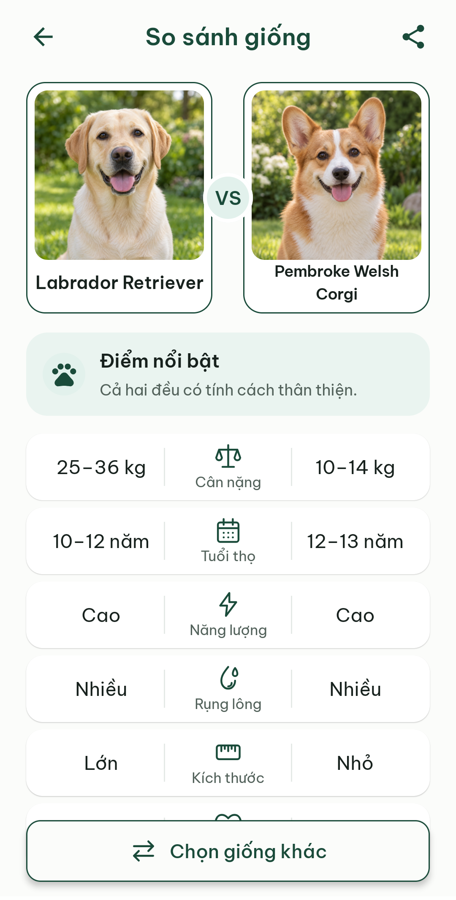</a></td></tr>
</table>

<a id="breeds"></a>

### Tra cứu và so sánh giống chó

<details>
<summary>▶ Video 02: Khám phá giống chó</summary>

https://github.com/user-attachments/assets/91f8e451-1549-4f55-9858-ebf6d9c2d303

</details>

Khám phá danh mục 163 giống chó, tìm kiếm/lọc, xem thông tin và so sánh hai giống. Catalog được tải qua HTTPS; nội dung đã cache có thể xem lại khi offline.

<table>
<tr><th>Danh mục giống chó</th><th>Thông tin giống</th><th>So sánh hai giống</th></tr>
<tr><td><a href="screenshots/03-breed-explorer/breed-catalog.png">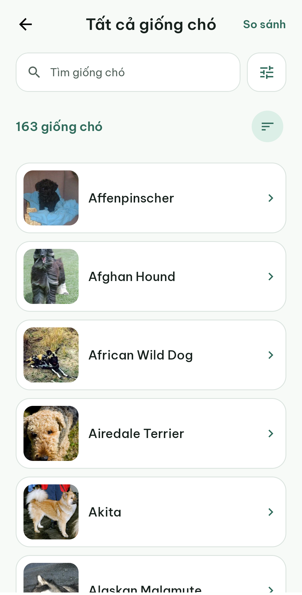</a></td><td><a href="screenshots/03-breed-explorer/breed-detail.png">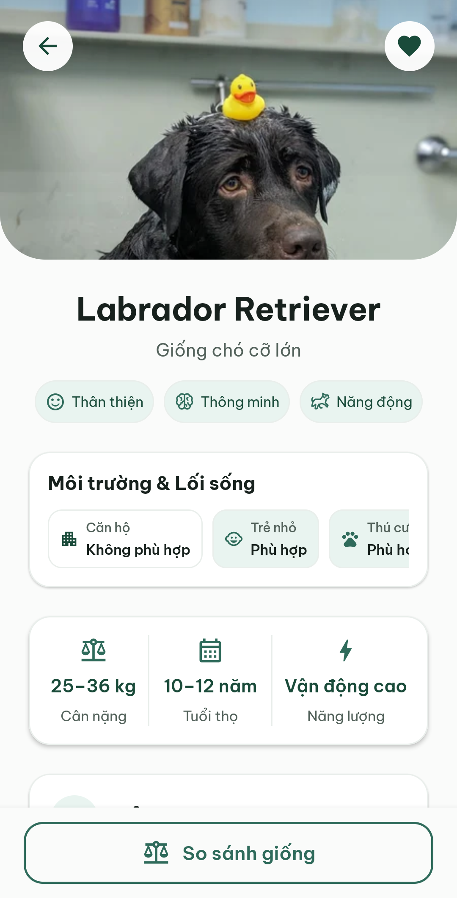</a></td><td><a href="screenshots/03-breed-explorer/breed-comparison.png"></a></td></tr>
</table>

<a id="library"></a>

### Lịch sử và giống yêu thích

<details>
<summary>▶ Video 03: Lịch sử và giống yêu thích</summary>

https://github.com/user-attachments/assets/4412ba5a-384c-416a-893a-1fa51d8d394a

</details>

Theo dõi lịch sử nhận diện, mở lại kết quả và quản lý các giống yêu thích.

<table>
<tr><th>Lịch sử nhận diện</th><th>Giống yêu thích</th></tr>
<tr><td><a href="screenshots/04-personal-library/scan-history.png">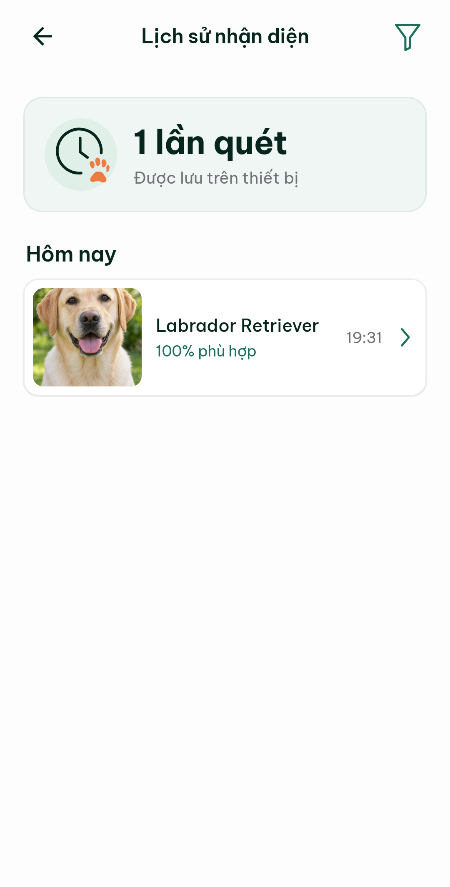</a></td><td><a href="screenshots/04-personal-library/favorite-breeds.png">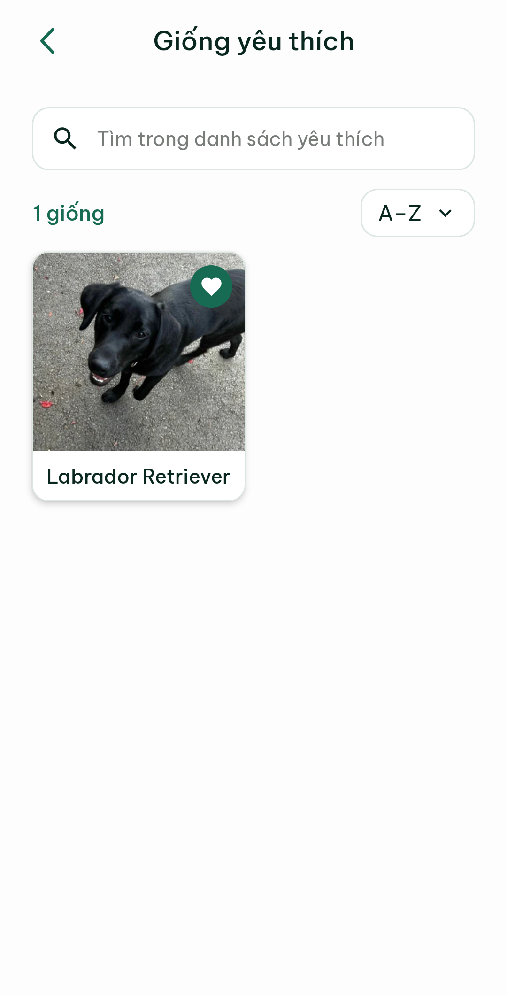</a></td></tr>
</table>

<a id="pets"></a>

### Quản lý hồ sơ thú cưng

<details>
<summary>▶ Video 05: Hồ sơ thú cưng</summary>

https://github.com/user-attachments/assets/1b63cf12-314a-4252-8f17-bec7b5b9fdd0

</details>

Tạo và chỉnh sửa hồ sơ với tên, giống, giới tính, ngày sinh, cân nặng, ghi chú, ảnh đại diện và album ảnh. Milo là hồ sơ demo được tạo cho bộ tài liệu này.

<table>
<tr><th>Danh sách thú cưng</th><th>Chỉnh sửa hồ sơ</th><th>Hồ sơ và album ảnh</th></tr>
<tr><td><a href="screenshots/05-pet-management/pets.png">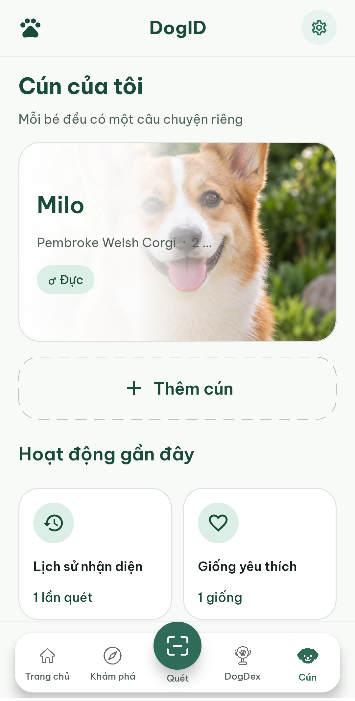</a></td><td><a href="screenshots/05-pet-management/pet-edit.png">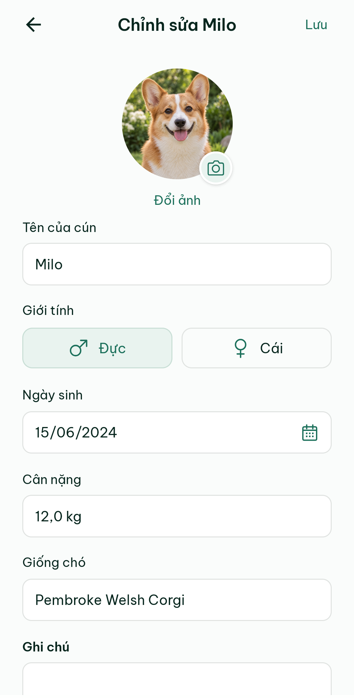</a></td><td><a href="screenshots/05-pet-management/pet-profile.png">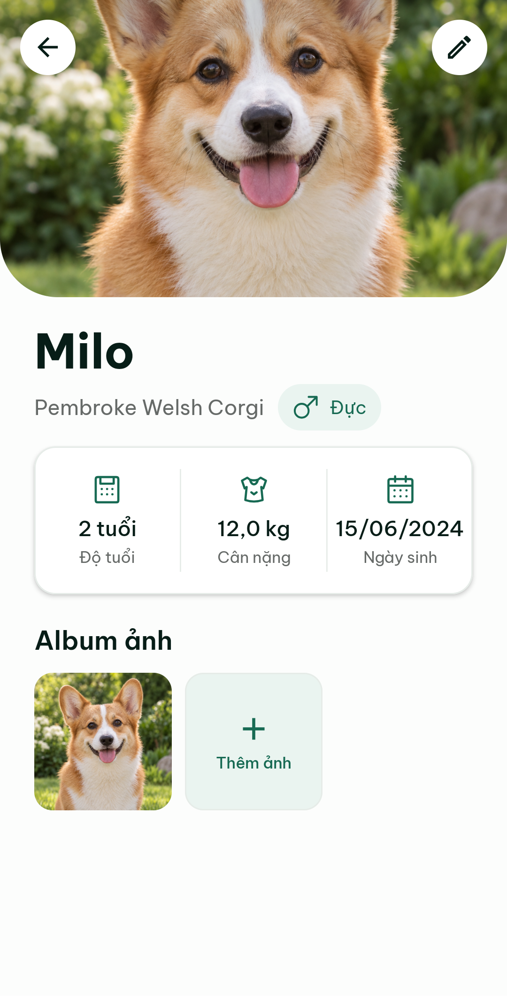</a></td></tr>
</table>

<a id="dogdex"></a>

### Bộ sưu tập DogDex

<details>
<summary>▶ Video 04: Bộ sưu tập DogDex</summary>

https://github.com/user-attachments/assets/505cd08c-7af8-4897-8a2b-6a95e03dba63

</details>

Theo dõi các giống đã khám phá, tiến độ bộ sưu tập, trạng thái đã quét và các giống yêu thích.

<table>
<tr><th>Bộ sưu tập DogDex</th></tr>
<tr><td><a href="screenshots/06-dogdex/collection.png">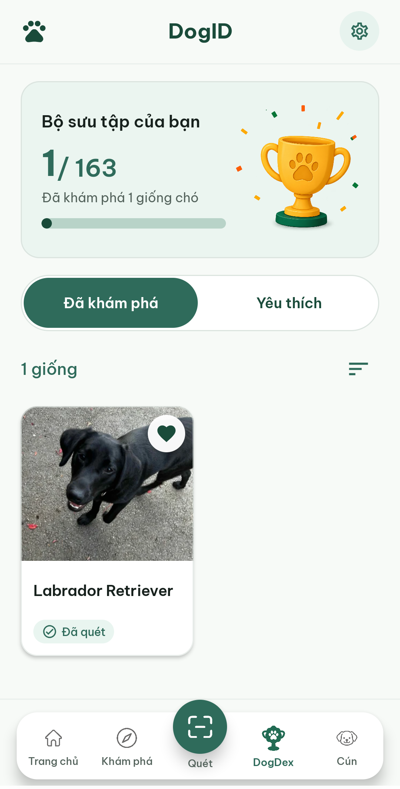</a></td></tr>
</table>

<a id="share"></a>

### Tạo ảnh chia sẻ

<details>
<summary>▶ Video 06: Tạo thẻ chia sẻ</summary>

https://github.com/user-attachments/assets/76b2c02e-b807-46a3-9280-0eb2b170af6b

</details>

Tùy chọn 6 mẫu thiết kế và 5 tỷ lệ ảnh, xem trước và xuất thẻ PNG để lưu hoặc chia sẻ qua Android Sharesheet.

<table>
<tr><th>Tùy chỉnh thẻ chia sẻ</th><th>Mẫu chia sẻ khác</th></tr>
<tr><td><a href="screenshots/07-share-card/share-editor.png">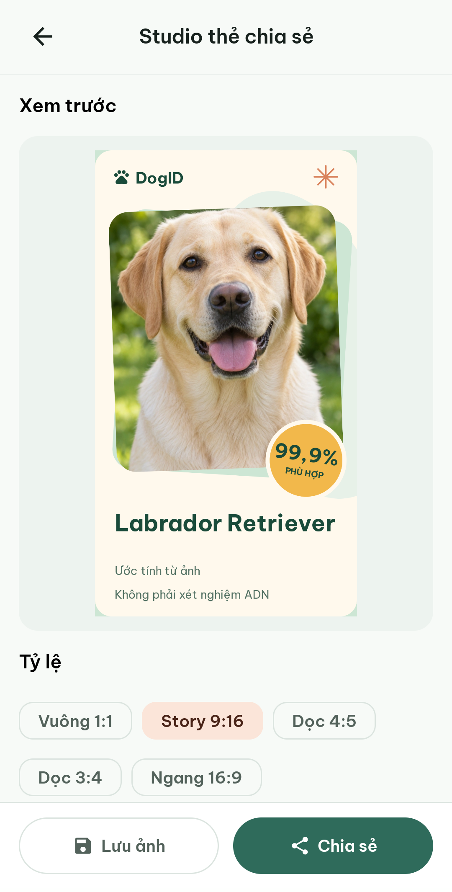</a></td><td><a href="screenshots/07-share-card/share-template.png">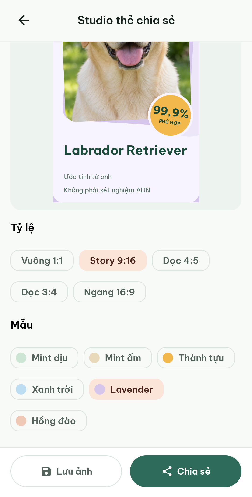</a></td></tr>
</table>

<a id="settings"></a>

### Cài đặt và ngôn ngữ

<details>
<summary>▶ Video 07: Cài đặt và trợ giúp</summary>

https://github.com/user-attachments/assets/ef49053b-944b-4486-8f2f-f269b67b6582

</details>

Hỗ trợ 20 locale, quản lý bộ nhớ và các mục trợ giúp, quyền riêng tư, thông tin ứng dụng.

<table>
<tr><th>Cài đặt</th><th>Lựa chọn ngôn ngữ</th></tr>
<tr><td><a href="screenshots/08-settings/settings.png">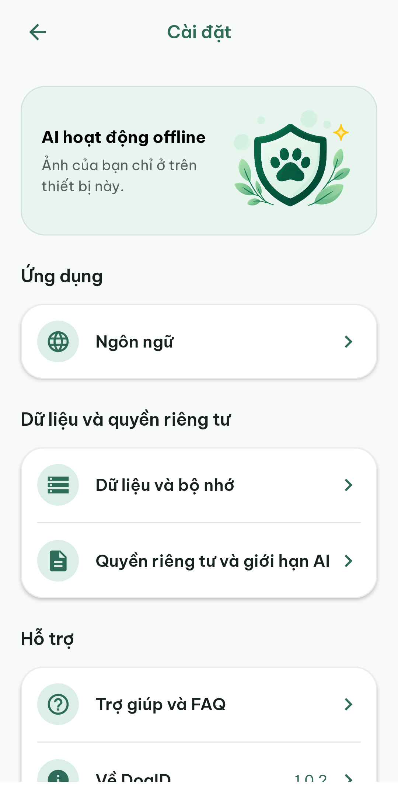</a></td><td><a href="screenshots/08-settings/language-selection.png">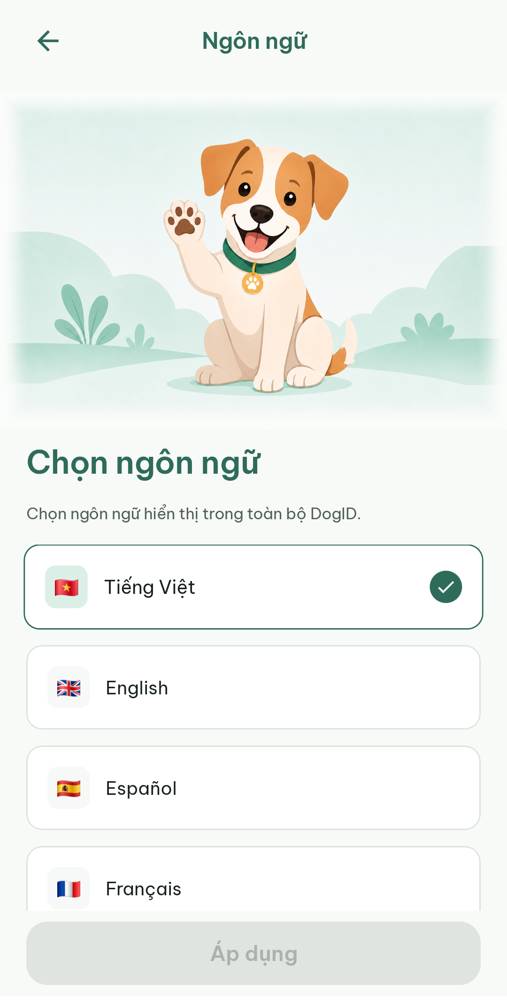</a></td></tr>
</table>

## 🧩 Kiến trúc và cách tổ chức

Ứng dụng tách giao diện, logic nghiệp vụ và nguồn dữ liệu. ViewModel cung cấp UI state bằng StateFlow, phát sự kiện bằng SharedFlow; Compose thu thập trạng thái theo lifecycle. Hilt cung cấp các implementation cho repository và các thành phần dùng chung.

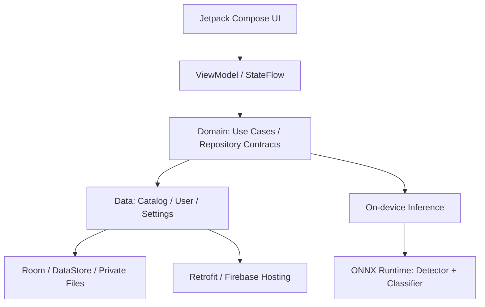

Xác suất trong kết quả là mức độ tin cậy của bộ phân loại, không phải tỷ lệ di truyền hay kết quả xét nghiệm giống chó.

## 📁 Cấu trúc tài liệu

```text
DogID_docs/
├── README.md
├── screenshots/
│   ├── README.md
│   ├── 01-overview/
│   ├── 02-dog-recognition/
│   ├── 03-breed-explorer/
│   ├── 04-personal-library/
│   ├── 05-pet-management/
│   ├── 06-dogdex/
│   ├── 07-share-card/
│   └── 08-settings/
└── videos/
    ├── README.md
    ├── covers/
    ├── 01-recognition-comparison.mp4
    ├── 02-breed-explorer.mp4
    ├── 03-history-favorites.mp4
    ├── 04-dogdex.mp4
    ├── 05-pet-management.mp4
    ├── 06-share-card.mp4
    └── 07-settings.mp4
```

## 👨‍💻 Tác giả

**Nguyễn Việt Anh — Android Developer**

- GitHub: [vietanh-k04](https://github.com/vietanh-k04)
- Email: [vietanh.work.it@gmail.com](mailto:vietanh.work.it@gmail.com)
