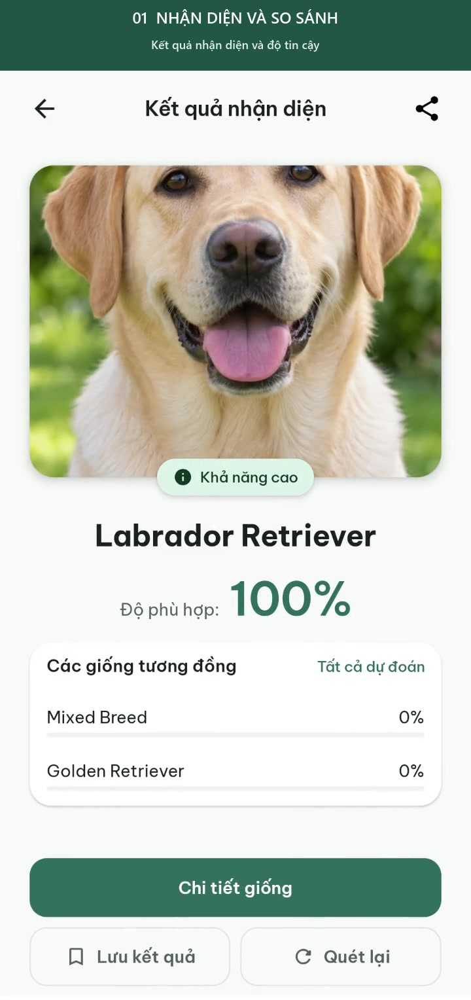
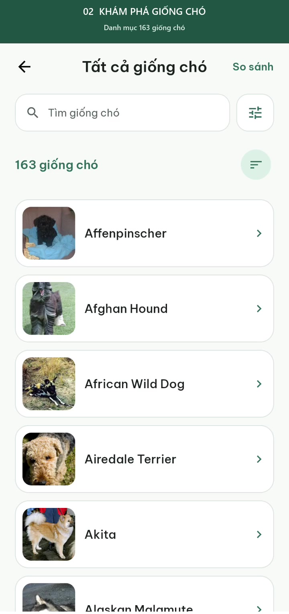
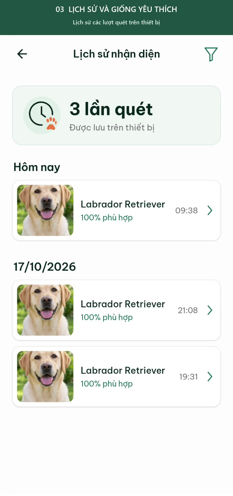
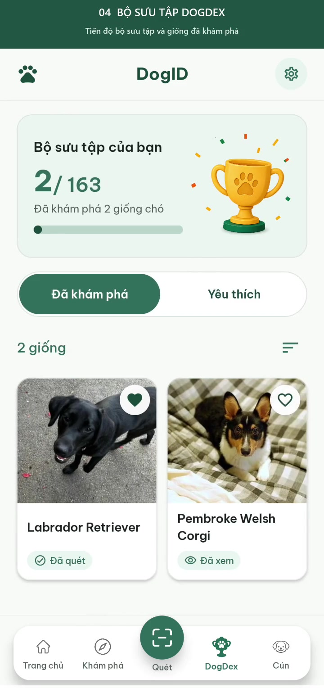
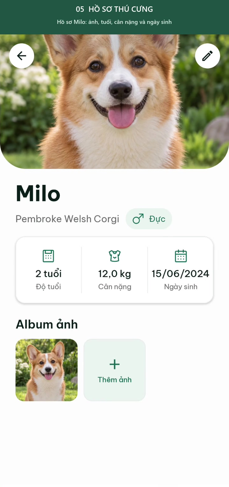
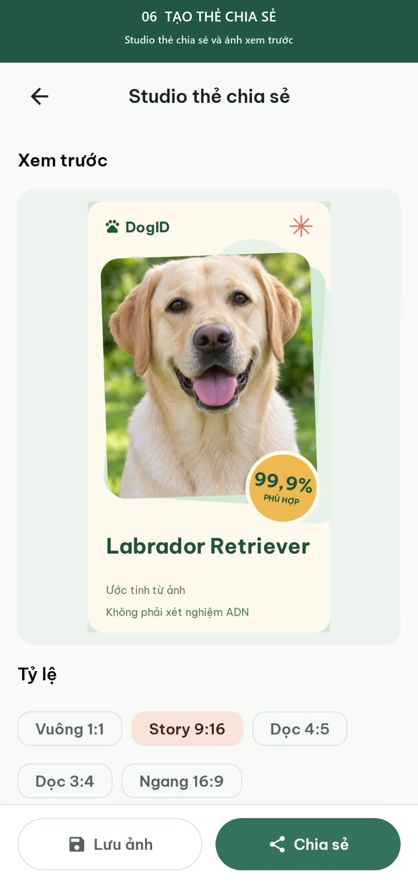
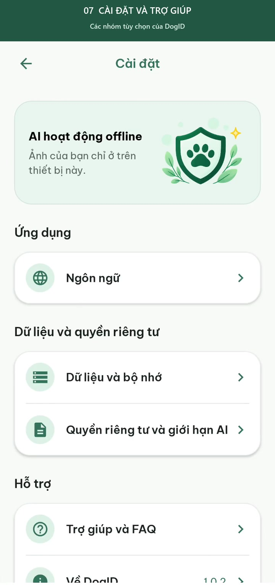

# Video demo DogID theo từng luồng

[← Giới thiệu dự án](../README.md)

Mỗi video là một luồng riêng, bắt đầu từ **Home** và quay ở **tốc độ thật (1×)**. Không gộp các tính năng khác nhau vào một video tổng hợp.

| Video | Thời lượng | Dung lượng |
| --- | --- | --- |
| [▶ 01. Nhận diện và so sánh](01-recognition-comparison.mp4) | 01:39 | 2.52 MiB |
| [▶ 02. Khám phá giống chó](02-breed-explorer.mp4) | 01:13 | 1.64 MiB |
| [▶ 03. Lịch sử và giống yêu thích](03-history-favorites.mp4) | 01:09 | 1.22 MiB |
| [▶ 04. Bộ sưu tập DogDex](04-dogdex.mp4) | 00:37 | 0.56 MiB |
| [▶ 05. Hồ sơ thú cưng](05-pet-management.mp4) | 00:59 | 1.35 MiB |
| [▶ 06. Tạo thẻ chia sẻ](06-share-card.mp4) | 00:59 | 1.48 MiB |
| [▶ 07. Cài đặt và trợ giúp](07-settings.mp4) | 01:13 | 2.07 MiB |

## 01. Nhận diện và so sánh

**Luồng:** Home → Chọn ảnh → Xác nhận ảnh → Crop → AI → Kết quả → Top 5 → Chi tiết giống → So sánh → Home

[▶ Xem video](01-recognition-comparison.mp4)

Các bước và mốc thời gian

| Mốc | Bước thao tác |
| --- | --- |
| 00:01 | Home · Bắt đầu nhận diện |
| 00:10 | Chọn ảnh Labrador demo trong thư viện hệ thống |
| 00:15 | Xác nhận ảnh đã chọn bằng nút Xong |
| 00:22 | Điều chỉnh vùng cắt ảnh |
| 00:28 | AI nhận diện trực tiếp trên thiết bị |
| 00:37 | Kết quả nhận diện và độ tin cậy |
| 00:44 | Xem đủ Top 5 dự đoán |
| 00:52 | Thông tin giống chó vừa nhận diện |
| 00:56 | Đọc đặc điểm và thông tin chăm sóc |
| 01:02 | Chọn giống thứ hai để so sánh |
| 01:08 | Đã chọn Labrador và Corgi |
| 01:13 | So sánh đặc điểm của hai giống |
| 01:18 | Xem phần còn lại của bảng so sánh |
| 01:37 | Trở lại Home |

## 02. Khám phá giống chó

**Luồng:** Home → Khám phá → Danh mục → Tìm kiếm → Chi tiết giống → Bộ lọc → Home

[▶ Xem video](02-breed-explorer.mp4)

Các bước và mốc thời gian

| Mốc | Bước thao tác |
| --- | --- |
| 00:01 | Home · Khám phá giống chó |
| 00:07 | Trang khám phá: gợi ý và giống phổ biến |
| 00:13 | Danh mục 163 giống chó |
| 00:22 | Tìm kiếm giống chó theo tên |
| 00:28 | Chi tiết giống từ kết quả tìm kiếm |
| 00:32 | Thông tin đặc điểm và chăm sóc |
| 00:45 | Bộ lọc kích thước, vận động và rụng lông |
| 00:52 | Danh sách sau khi lọc giống cỡ nhỏ |
| 00:58 | Bỏ bộ lọc, xem lại danh mục |
| 01:11 | Trở lại Home |

## 03. Lịch sử và giống yêu thích

**Luồng:** Home → Lịch sử → Lọc → Xem lại kết quả → Cún → Giống yêu thích → Chi tiết giống → Home

[▶ Xem video](03-history-favorites.mp4)

Các bước và mốc thời gian

| Mốc | Bước thao tác |
| --- | --- |
| 00:01 | Home · Mở lịch sử nhận diện |
| 00:07 | Lịch sử các lượt quét trên thiết bị |
| 00:16 | Lọc theo thời gian và giống chó |
| 00:24 | Các lượt quét trong 7 ngày gần đây |
| 00:30 | Mở lại kết quả nhận diện đã có |
| 00:41 | Danh sách các giống đã đánh dấu yêu thích |
| 00:47 | Xem thông tin giống từ danh sách yêu thích |
| 01:04 | Trở lại Home |

## 04. Bộ sưu tập DogDex

**Luồng:** Home → DogDex → Đã khám phá → Yêu thích → Chi tiết giống → Home

[▶ Xem video](04-dogdex.mp4)

Các bước và mốc thời gian

| Mốc | Bước thao tác |
| --- | --- |
| 00:01 | Home · Mở bộ sưu tập DogDex |
| 00:07 | Tiến độ bộ sưu tập và giống đã khám phá |
| 00:15 | Lọc bộ sưu tập theo giống yêu thích |
| 00:24 | Mở chi tiết giống từ DogDex |
| 00:35 | Trở lại Home |

## 05. Hồ sơ thú cưng

**Luồng:** Home → Cún → Form thêm cún → Hồ sơ Milo → Album ảnh → Form chỉnh sửa → Home

[▶ Xem video](05-pet-management.mp4)

Các bước và mốc thời gian

| Mốc | Bước thao tác |
| --- | --- |
| 00:01 | Home · Mở quản lý thú cưng |
| 00:07 | Danh sách thú cưng và hoạt động gần đây |
| 00:13 | Form thêm cún: thông tin cơ bản |
| 00:18 | Form thêm cún: giống, cân nặng và ghi chú |
| 00:25 | Hồ sơ Milo: ảnh, tuổi, cân nặng và ngày sinh |
| 00:30 | Album ảnh của Milo |
| 00:38 | Mở form chỉnh sửa hồ sơ hiện có |
| 00:42 | Các trường giống chó và ghi chú |
| 00:57 | Trở lại Home |

## 06. Tạo thẻ chia sẻ

**Luồng:** Home → Kết quả gần nhất → Studio chia sẻ → Mẫu và tỷ lệ → Xem trước → Lưu PNG → Home

[▶ Xem video](06-share-card.mp4)

Các bước và mốc thời gian

| Mốc | Bước thao tác |
| --- | --- |
| 00:01 | Home · Mở kết quả để tạo thẻ chia sẻ |
| 00:07 | Kết quả nhận diện được dùng làm nội dung thẻ |
| 00:13 | Studio thẻ chia sẻ và ảnh xem trước |
| 00:18 | Lựa chọn tỷ lệ và 6 mẫu thiết kế |
| 00:29 | Xem trước thẻ vuông 1:1 |
| 00:38 | Đổi sang tỷ lệ Story 9:16 |
| 00:44 | Lưu thẻ PNG vào thư viện thiết bị |
| 00:56 | Trở lại Home |

## 07. Cài đặt và trợ giúp

**Luồng:** Home → Cài đặt → Ngôn ngữ → Bộ nhớ → Quyền riêng tư → FAQ → Về DogID → Home

[▶ Xem video](07-settings.mp4)

Các bước và mốc thời gian

| Mốc | Bước thao tác |
| --- | --- |
| 00:01 | Home · Mở cài đặt |
| 00:07 | Các nhóm tùy chọn của DogID |
| 00:13 | Chọn ngôn ngữ hiển thị |
| 00:18 | Các ngôn ngữ khác trong danh sách |
| 00:23 | Xem dung lượng model, ảnh và dữ liệu ứng dụng |
| 00:30 | Quyền truy cập và xử lý ảnh trên thiết bị |
| 00:35 | Thông tin minh bạch và giới hạn của AI |
| 00:42 | Hướng dẫn nhanh và câu hỏi thường gặp |
| 00:51 | Mở câu trả lời trong FAQ |
| 01:00 | Thông tin và phiên bản ứng dụng |
| 01:11 | Trở lại Home |

## Thông tin bản quay

- Thiết bị: Samsung Galaxy A15 (SM-A155F), Android 16.
- Ứng dụng: DogID 1.0.2; ngày quay: 18/10/2026.
- Định dạng: MP4/H.264, 720 × 1528, 30 fps, không thu âm.
- Nhịp phát: 1×, không tăng tốc và không cắt bỏ bước điều hướng trong từng luồng.
- Giữ toàn bộ vùng giao diện app; phần thanh trạng thái/điều hướng hệ thống được cắt. Tiêu đề và bước thao tác đặt ở dải riêng phía trên.
- Video 1 quay cả thao tác mở bộ chọn ảnh từ Home, chọn ảnh demo và bấm Xong; thumbnail ảnh khác trên máy được che.
- Video hồ sơ mở form thêm cún để giới thiệu các trường và dùng hồ sơ Milo demo có sẵn để xem album/form chỉnh sửa; không tạo thêm hồ sơ mới trong video này.

## Xem trên GitHub

Nhấn tên hoặc ảnh bìa của video muốn xem. Nếu trang xem file không phát trực tiếp, chọn **Download raw file** để mở/tải MP4. Có thể dùng URL attachment GitHub sau khi upload để nhúng player cho từng video trong README.
